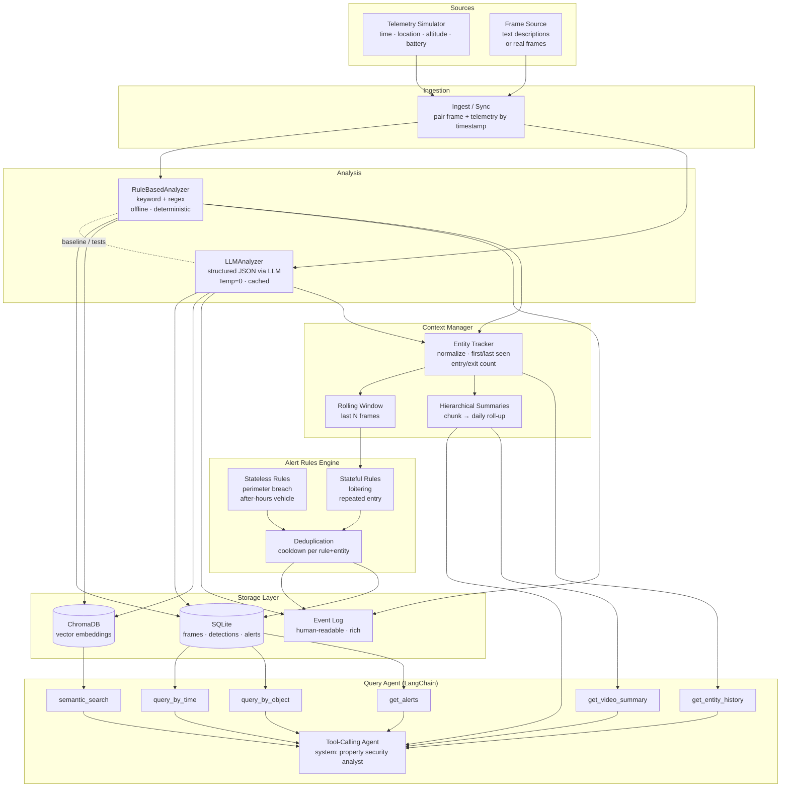

# Architecture — Drone Security Analyst Agent

## Pipeline Overview (Mermaid)



---

## Component Descriptions

### Telemetry Simulator + Frame Source
Two independent sources that produce paired data. The ingestion layer syncs them by timestamp. The `FrameSource` interface is the same whether frames come from a JSON scenario file or from OpenCV frames (future).

### Ingestion / Sync (`ingest.py`)
Iterates the scenario, calls the selected analyzer, then fans out to: event log, SQLite + vector index, and context manager. This is the main pipeline loop.

### Frame Analyzer (`analyzer/`)
Three implementations behind a common `BaseAnalyzer` interface:
- **RuleBasedAnalyzer**: keyword/regex dictionaries. No API key. Used in all automated tests.
- **LLMAnalyzer**: sends description + telemetry to the LLM with a strict JSON schema prompt. Caches by description hash to avoid redundant API calls. Temperature 0 for determinism.
- **VLMAnalyzer** (future): adds an image captioning step before the LLM.

### Context Manager (`context.py`)
Tracks entities across frames. The entity key normalises detections to `label:color:make:model` so "F-150", "Ford pickup", and "Blue Ford F150" all resolve to `vehicle:blue:ford:f150`. Hierarchical summaries are built every K frames so the agent always gets a compact context, not raw frame logs.

### Alert Rules Engine (`alerts.py`)
Pure Python — no LLM involvement. Rules are stateless (single-frame checks like perimeter breach) or stateful (rolling-window checks like loitering). A cooldown map prevents the same alert firing every frame. Alert messages follow the format `"{Subject} {behavior} at {location}, {HH:MM}."`.

### Index (`index/`)
Dual-store:
- **SQLite** for exact queries: time range, object label/subtype/color, location.
- **ChromaDB** for semantic queries: embed `description + summary` per frame, store metadata for filtering.
- **Hybrid search** (`search.py`): SQL metadata pre-filter, then vector re-rank on the filtered subset.

### Query Agent (`agent.py`)
LangChain tool-calling agent. Receives the user's question, calls one or more tools, and assembles a grounded answer with frame citations. It uses the hierarchical summaries from the context manager so it can reason about the full session without a prompt proportional to the frame count.

---

## Design Decisions

| Decision | Rationale |
|---|---|
| Text-simulated frames as the primary mode | Deterministic, free, no model setup needed. Tests pass in CI without an API key. |
| Rules engine in plain Python | Alerts must be auditable and fast. The LLM explains; it does not decide. |
| SQLite not PostgreSQL | Zero setup, no server, file-portable. Sufficient for prototype-scale (up to ~1M frames before needing indexing tuning). |
| ChromaDB not FAISS | Persistent by default, metadata filtering API, good LangChain integration. FAISS would need a manual persistence wrapper. |
| `sentence-transformers/all-MiniLM-L6-v2` embeddings | Local (no API cost), 384-dim, fast (CPU-viable), well-tested on semantic similarity tasks. |
| Entity key normalisation | Enables cross-frame tracking without a dedicated ML re-ID model; good enough for the prototype. |
| Hierarchical summaries | Keeps agent prompt size O(log n) instead of O(n) as the session grows. |

---

## Data Flow for a Single Frame

```
Frame description + Telemetry
        │
        ▼
  Analyzer.analyze()
        │
        ▼
  AnalyzedFrame (Pydantic)
   ├─ detections[]
   └─ summary string
        │
   ┌────┴────────────────────┐
   ▼                         ▼
SQLite insert             ChromaDB upsert
(frames + detections)     (embedding of description+summary)
   │                         
   ▼                         
Context Manager           
  ├─ update entity tracker  
  ├─ append to rolling window
  └─ maybe flush chunk summary
        │
        ▼
  Alert Rules evaluate(analyzed_frame, context)
        │
        ▼
  Alerts → SQLite + console + log file
```

---

## AI Assistance in Architecture Design

This architecture was developed with Kiro (Claude) using the prompt:
> "Propose a pipeline for a drone security analyst agent that ingests simulated telemetry and text frame descriptions, analyzes detections, fires deterministic alerts, and exposes a LangChain Q&A agent. Justify each component choice."

**What AI suggested**: the overall pipeline shape, the dual-store index, and the hierarchical summary pattern for context management.

**What was changed**: switched from an event-bus model (Kafka was initially suggested) to a simple synchronous pipeline loop — Kafka adds operational complexity that is not justified at prototype scale. Added the entity-key normalisation approach for vehicle re-identification (AI did not suggest this explicitly).
